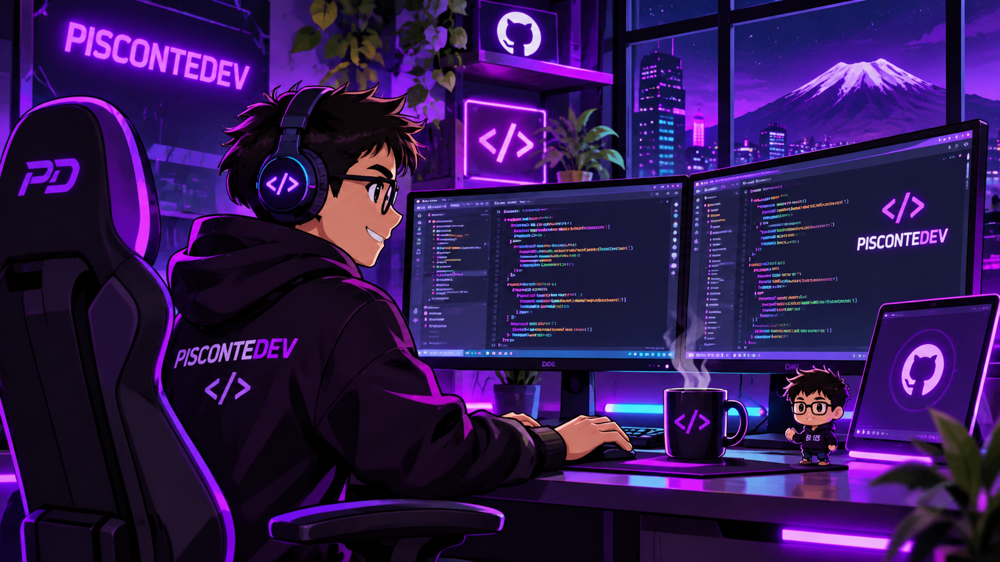

# PISCONTEDEV

**FULL-STACK DEVELOPER** · Arequipa, Perú

`Laravel` · `React` · `Next.js` · `TypeScript` · `.NET`

**🟣 Disponible para proyectos**

---

### `> sobre mí`

Soy **Santiago Pisconte**, desarrollador de software especializado en construir aplicaciones web y soluciones de negocio de extremo a extremo. Trabajo con **Laravel, React y Next.js**, desde el diseño de interfaces y APIs hasta la integración de datos y el despliegue.

Me interesa crear software **mantenible, eficiente y preparado para evolucionar**. También he trabajado con **C# y Unity** en experiencias interactivas y desarrollo 3D.

 

### `> áreas de trabajo`

| Especialidad | Enfoque |
| :--- | :--- |
| **🌐 Desarrollo Full Stack** | Aplicaciones web, paneles administrativos y plataformas empresariales. |
| **⚙️ Backend y APIs** | Lógica de negocio, autenticación, integraciones y servicios REST. |
| **🧩 Arquitectura de software** | Separación de responsabilidades, mantenibilidad y escalabilidad. |
| **🎮 Unity y 3D** | Experiencias interactivas y desarrollo con C#. |

### `> tecnologías`

**Frontend**  
    

**Backend**  
    

**Datos y herramientas**  
      

### `> proyectos`

He participado en el desarrollo de **plataformas de gestión, sistemas empresariales, aplicaciones móviles y soluciones interactivas**. Puedes conocer mis proyectos, tecnologías y trayectoria en mi portafolio.

**[Explorar proyectos en PISCONTEDEV](https://piscontedev.dailyia.com/)**

### `> actividad en GitHub`

---

**¿Tienes un proyecto o una idea?**  
Conversemos sobre cómo convertirla en una solución útil y sostenible.

[**Contáctame**](mailto:santiagopisconte20@gmail.com) · [**LinkedIn**](https://www.linkedin.com/in/santiago-pisconte/) · [**WhatsApp**](https://wa.me/51944777153)

© 2026 PISCONTEDEV · Diseño y desarrollo de software

